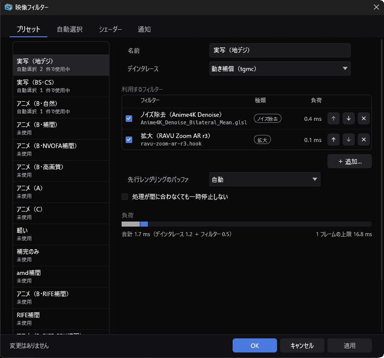
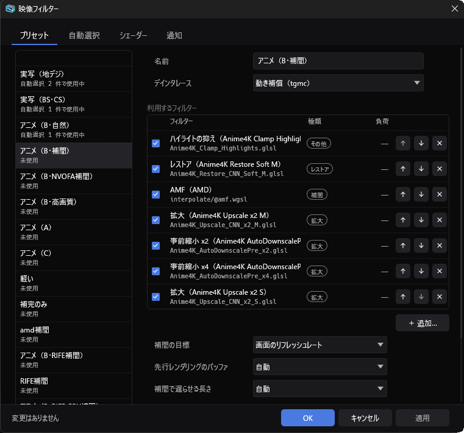

# video-filter

映像フィルターのプラグインです。
mpv のユーザーシェーダー（`.glsl`・`.hook`、Anime4K・FSRCNNX・nnedi3・ravu など）と自前の WGSL（`.wgsl`）を、プリセットと自動選択で番組ごとに指定できます。
フレーム補間も、フィルターの一つとして使えます。補間すると、画面のリフレッシュレートか、指定したフレームレートで表示します。
デインタレースも、ZeroWave の標準のものの代わりにこのプラグインのシェーダーで行えます。

## ビルド

```sh
rustup target add wasm32-unknown-unknown
cargo build --release --target wasm32-unknown-unknown -p zerowave-video-filter
```

できあがった `target/wasm32-unknown-unknown/release/zerowave_video_filter.wasm` を、`video_filter.wasm` という名前で ZeroWave の `plugins` フォルダーにコピーします。

## シェーダーの置き場所

シェーダーのファイルは `plugins/video_filter` フォルダーに置きます。
デインタレース用のシェーダーは `plugins/video_filter/deinterlace`、フレーム補間用のシェーダーは `plugins/video_filter/interpolate` に置きます。
フォルダーの場所は、設定の「シェーダーのフォルダー」で変更できます。

## プリセットと自動選択

どのシェーダーを使うかは、プリセットで決めます。
プリセットには、デインタレースを一つと、フィルターを好きな数だけ順番に登録します。

自動選択を使うと、番組に合わせてプリセットが切り替わります。
条件には、ジャンル、ネットワーク、チャンネル、解像度、インタレースかプログレッシブか、番組名、時間帯、放送か録画かを使えます。
どの条件にも合わないときは、「条件に一致しない場合」のプリセットが使われます。

設定は、プラグインの一覧の「設定…」から開くウィンドウで行います。
「プリセット」「自動選択」「シェーダー」「通知」のタブがあります。



プリセットの下には、フィルターごとの処理時間と、その合計が 1 フレームに使える時間のどれだけになるかが表示されます。

シェーダーを追加するには、「シェーダー」タブの「＋ 追加…」でファイルを選び、名前と種類を入力します。デインタレース用に追加できるのは `.wgsl` のシェーダーだけです。
再生中にプリセットを切り替えるには、右クリックメニューの「プラグイン › シェーダー」を使います。手動で選んだプリセットは、チャンネルを変えるまで使われます。

設定は `plugins/video_filter.toml` に保存されます。
このファイルが無いときは、フィルターを使いません。
シェーダーのファイルを書き換えると、再生を続けたまま反映されます。

## 使えるシェーダー

- mpv のユーザーシェーダー（`.glsl`・`.hook`）。`MAIN`・`NATIVE`・`PREKERNEL` などの画像と、`LUMA` を対象にしたシェーダーが使えます。nnedi3・ravu・FSRCNNX の拡大のような `LUMA` のシェーダーは、輝度に対して処理した結果を元の画像に反映します。`POSTKERNEL`・`OUTPUT` のシェーダーは、画面の大きさに拡大してから処理します。`CHROMA` などのシェーダーは使えません。
- WGSL のシェーダー（`.wgsl`）。書き方は `src/native.rs` の先頭に、例は `examples/shaders` にあります（シャープネスの `sharpen.wgsl`、フレーム補間の `blend2x.wgsl`、デインタレースの `deinterlace/ela.wgsl` と `deinterlace/tgmc.wgsl`）。

`tgmc.wgsl` は、QTGMC を簡略にした、動き補償つきのデインタレースです。
前後のフィールドから動きを探し、それに合わせて重ね合わせることで、ちらつきの少ない映像にします。
24p の番組は、ZeroWave の逆テレシネと組み合わせて扱います。
RTX 2060 では、1440x1080 の 1 フレームを 7.8 ms で処理できます。

## フレーム補間

フレーム補間は、プリセットのフィルターに補間の方式を一つ加えると使えます。
補間を加えると、補間の目標（画面のリフレッシュレートか、指定したフレームレート）を選べるようになります。



方式は次のとおりです。
GPU や OS の機能を使う方式は、その環境でだけ選べます。

| 方式 | 使える環境 | 内容 |
| --- | --- | --- |
| VideoToolbox（macOS） | macOS 15.4 以降の Apple シリコン | macOS のフレームレート変換を使います。 |
| AMF（AMD） | Windows、AMD の GPU | AMD のフレームレート変換（FRC）を使います。2 倍の補間だけで、表示が 1〜2 フレーム遅れます。 |
| oneVPL（Intel） | Windows、Intel の GPU | Intel の AI フレーム補間を使います。2 倍の補間だけです。 |
| NVOFA（NVIDIA） | Windows・Linux、NVIDIA の GPU | NVIDIA の Optical Flow で動きを求め、それに沿ってフレームを作ります。まだ十分に調整できておらず、補間の質は AMF・oneVPL・VideoToolbox に及びません。 |
| 動き探しの補間（自動） | すべて | 使える方法で動きを求め、それに沿ってフレームを作ります。NVIDIA なら NVOFA、Intel の第 9 世代と Ice Lake なら GPU の動き検出、それ以外は GPU のシェーダーで求めます。NVOFA と同じく、補間の質は AMF・oneVPL・VideoToolbox に及びません。 |
| RIFE（GPU 共通） | すべて | RIFE を ZeroWave の GPU で動かします。モデルを別に用意します。 |
| RIFE（TensorRT・CoreML） | NVIDIA の GPU（Windows・Linux）、Mac | RIFE を別のプログラム（`zwtrt`・`zwcoreml`）で動かします。 |
| `interpolate/motion.wgsl` | すべて | 例として入っている、シェーダーだけで動き補償をする補間です。 |

### AMF・oneVPL・VideoToolbox

GPU のドライバーや OS に入っている補間をそのまま使います。
追加で用意するものはありません。
AMF と oneVPL は、ZeroWave が D3D12 で表示しているときに使えます。
AMF は処理の完了を待たずに次のフレームへ進むため、表示が 1〜2 フレーム遅れます。

### NVOFAの補間

GPU で前後のフレームの動き（オプティカルフロー）を求め、プラグインがその動きに沿って中間のフレームを作ります。
NVOFA は、Optical Flow のハードウェアを持つ NVIDIA の GPU で使えます。
「動き探しの補間（自動）」は、NVOFA が使えない GPU でも、使える方法を自動で選びます。
どちらも、動きからフレームを作る処理をまだ十分に調整できていないため、補間の質は AMF・oneVPL・VideoToolbox より劣ります。
プリセットの「先行レンダリングのバッファ」が自動のときは、250 ms 分を先に用意して処理の偏りをならします。

### RIFE（GPU 共通）

ZeroWave が使っている GPU で RIFE v4 を動かすので、TensorRT が無い環境（Mac、Linux、Radeon、Arc）でも使えます。
新しいフレームが来たときにだけネットワークの計算をし、その間のフレームは計算結果から軽い処理で作ります。
f16 が使える GPU では f16 で計算し、NVIDIA の Vulkan ではテンソルコアも使います。

- モデルは同梱していません。[rife-ncnn-vulkan](https://github.com/nihui/rife-ncnn-vulkan)（MIT）のリリースから `models/rife-v4.6` などのフォルダー（`flownet.param` と `flownet.bin` が入っています）を取り出し、`plugins/video_filter/rife-models` に置いてください。置き場所は設定の `rife_models` で変更できます。
- 設定の `rife_model` で使うモデル（フォルダー名）を選べます。既定は `rife-v4.6` で、`rife-v4.25-lite` なども使えます。
- 設定の `rife_scale` で、動きを計算するときの縮小率を選べます。`1`・`0.5`（既定）・`0.25` から選べ、小さいほど軽くなります。
- 設定の `rife_kernels` で計算の精度を選べます。`auto`（GPU に合わせる。既定）・`f16`（テンソルコアを使わない）・`f32` から選べます。
- Windows（D3D12）では、[DirectXShaderCompiler](https://github.com/microsoft/DirectXShaderCompiler/releases) の `dxcompiler.dll` と `dxil.dll` を ZeroWave と同じフォルダーに置いてください。無いとシェーダーのコンパイルにかなりの時間がかかります。
- 新しいフレームの処理だけが重いので、プリセットの「先行レンダリングのバッファ」が自動のときは、250 ms 分を先に用意して処理の偏りをならします。

1 フレームの処理時間（rife-v4.6、1440x1080）：

| GPU（API） | 等倍 | 1/2 | 1/4 |
|---|---|---|---|
| RTX 5060 Ti（D3D12） | 17.5 ms | 5.8 ms | 2.8 ms |
| Arc A380（D3D12） | 108.8 ms | 31.7 ms | 11.8 ms |
| Ryzen 9700X の内蔵 Radeon（D3D12） | 408 ms | 119 ms | 44 ms |
| Apple M2（Metal） | 128.8 ms | 39.3 ms | 15.4 ms |

### RIFE（TensorRT・CoreML）

RIFE を、NVIDIA の GPU では TensorRT で、Mac では CoreML で動かします。
ZeroWave とは別のプログラムとして動き、Windows・Linux では `zwtrt` を、macOS では [`zwcoreml`](zwcoreml/README.md) を使います。

- 設定の `rife_program` に、`zwtrt` か `zwcoreml` の実行ファイルを指定します。
- 設定の `rife_dir` に、モデル（ONNX・エンジン・CoreML のモデル）のフォルダーを指定します。空のときは実行ファイルと同じフォルダーを使います。
- `zwtrt` は TensorRT 10.16 と CUDA 13 を使います。DLL の場所は、設定の `rife_tensorrt` と `rife_cuda` で指定できます。
- 表示が 1〜2 フレーム遅れます。

モデルは同梱していません。

- `zwtrt`（Windows・Linux）は、[vs-mlrt](https://github.com/AmusementClub/vs-mlrt) が配布している RIFE の ONNX をそのまま使えます。
  vs-mlrt の[リリース](https://github.com/AmusementClub/vs-mlrt/releases)にある `models.<バージョン>.7z` を展開し、`models/rife/rife_v4.6.onnx` を `rife_dir` に `rife.onnx` という名前で置いてください。
  別の名前のまま使うときは、設定の `rife_onnx` にファイルを指定します。
  `models/rife_v2` にあるモデルは入力の形が違うため使えません。
  初めて使うときと映像の大きさが変わったときは、TensorRT のエンジンを作るので数分かかります。作ったエンジンは `rife_dir` に保存され、次からはすぐに始まります。
- `zwcoreml`（macOS）は、ONNX を使えません。モデルの作り方は [zwcoreml の README](zwcoreml/README.md) にあります。

## 試す

```sh
cargo nextest run -p zerowave-video-filter                                 # 例とテスト用の mpv シェーダーで試す
ZW_MPV_SHADERS=~/mpv-shaders cargo nextest run -p zerowave-video-filter   # 手元の mpv シェーダーを一つずつ試す
```
